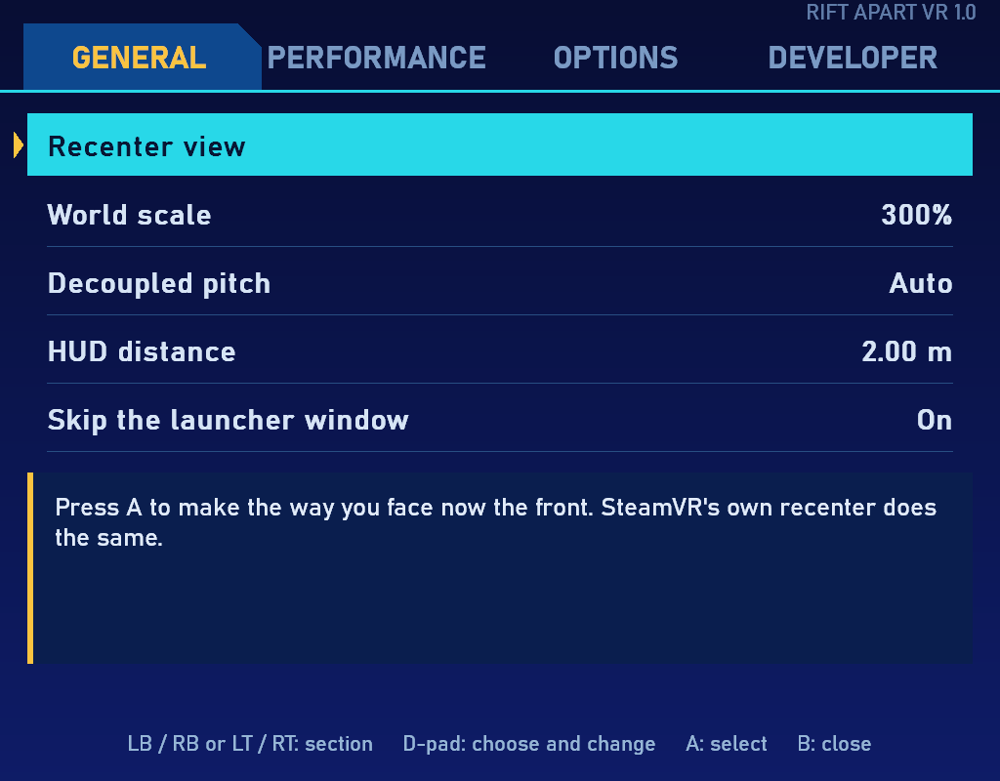
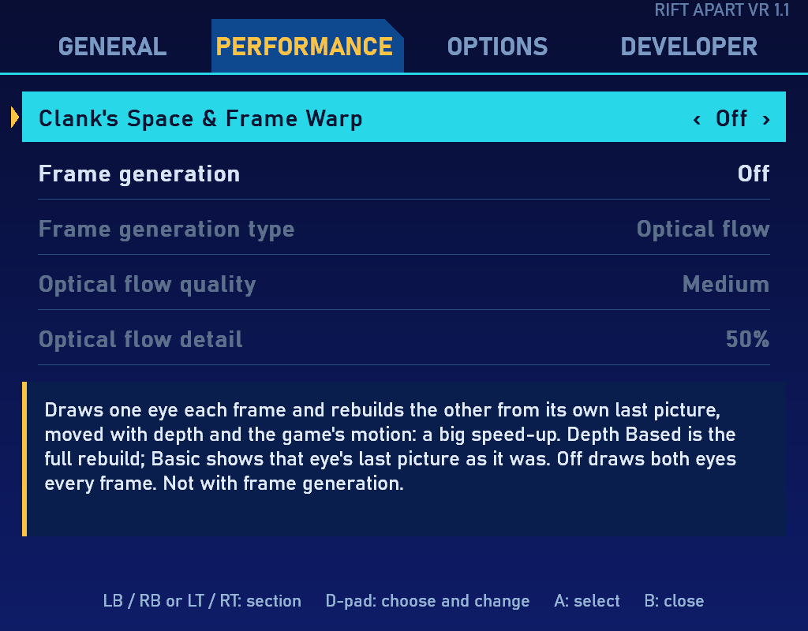
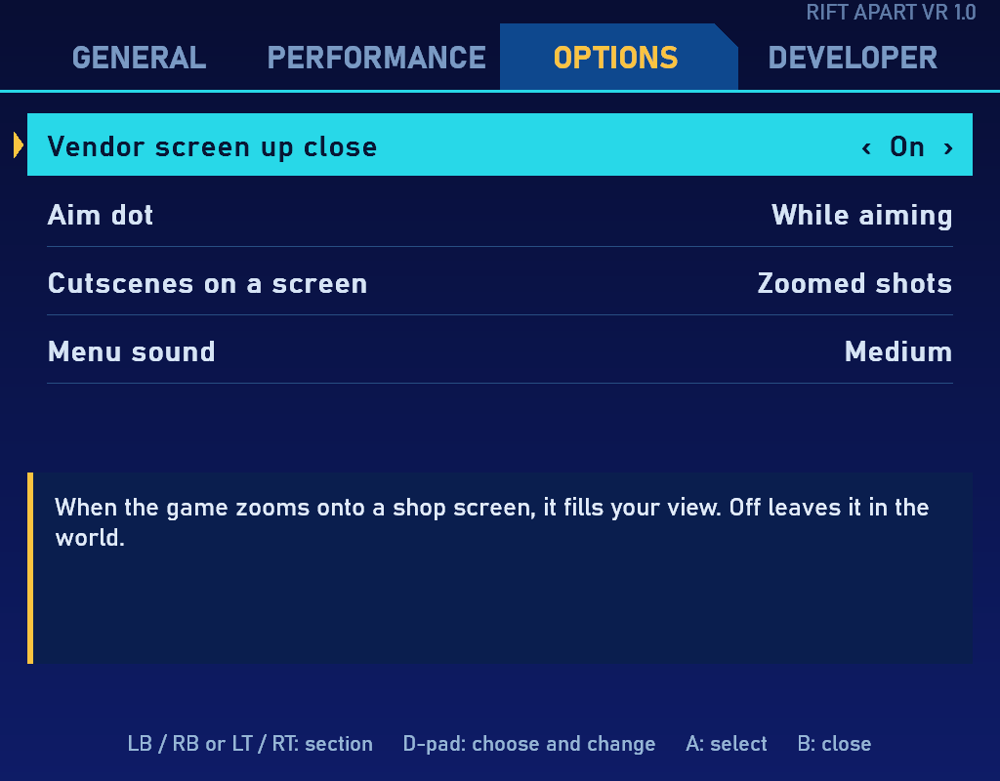
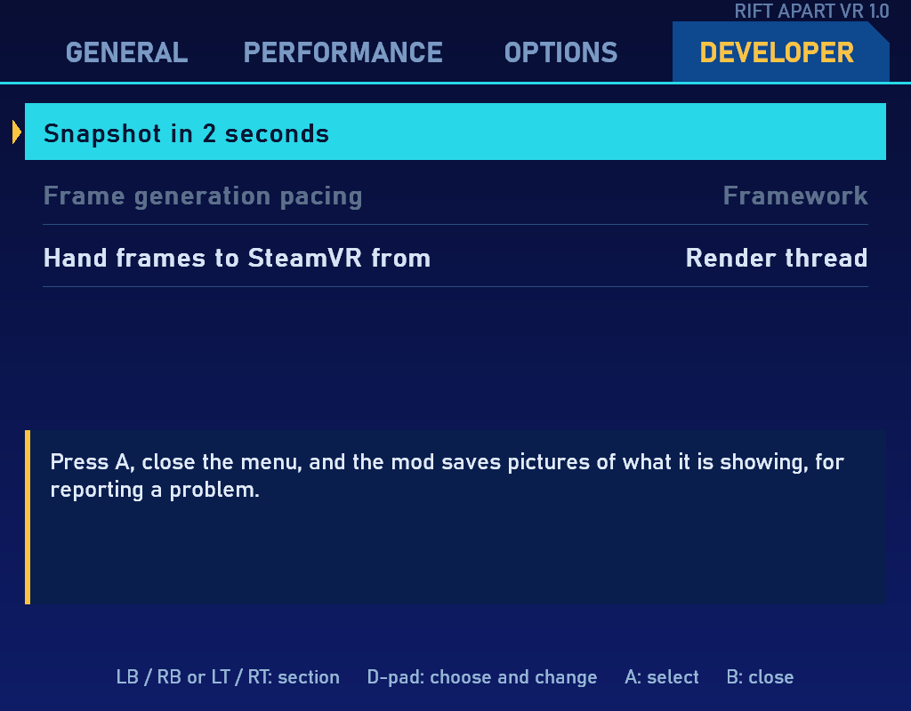

# Rift Apart VR: Ratchet & Clank: Rift Apart in VR

True stereo VR for Ratchet & Clank: Rift Apart. Both eyes are drawn from the same game tick, so there is no alternate-eye shimmer and no warping. You play in third person with a gamepad, in a solid 3D world that stays level around you; there are no motion controls. DLSS works in both eyes.

**Download:** see [Releases](../../releases).

**Support:** Rift Apart VR is free. If you enjoy it, you can [buy me a coffee](https://buymeacoffee.com/scubasteve2365).

## What you need

- The Steam version of Ratchet & Clank: Rift Apart (game version 3.630.1.0)
- A PC VR headset with a 64-bit OpenXR runtime. Two have been tested:
  - SteamVR, set as your OpenXR runtime (SteamVR settings, OpenXR)
  - Virtual Desktop's VDXR, for headsets like the Meta Quest 3
- A gamepad
- For DLSS in both eyes, an NVIDIA RTX card. With another upscaler chosen in the game, the eyes draw at full size

## Install

1. Unzip the release anywhere. Keep `Install Rift Apart VR.bat`, `winhttp.dll`, `openxr_loader.dll` and the `ofxr` folder together.
2. Double click `Install Rift Apart VR.bat` and type 1. It finds the game through Steam. If Microsoft's Visual C++ runtime is missing, it offers to download it from Microsoft; only frame generation's DLSS-G type needs it.
3. Start SteamVR or connect Virtual Desktop, then start the game from Steam. VR starts by itself.
4. Set the game's own graphics settings as in [Game settings](#game-settings). Texture Quality matters most.

To uninstall, run the same bat file and type 2. Your earlier `winhttp.dll`, if another mod had one, is put back. If the bat cannot find the game, run it from a command prompt with the game folder in double quotes after its name.

The mod is not signed, so Windows may warn you about the bat file. It is plain text, so you can read it first. Windows Smart App Control can block unsigned mod DLLs. If it is on and the game stays flat, that is the likely cause.

## Settings

Click and hold both thumbsticks for half a second to open the menu in the headset. The game does not see your gamepad while it is open. Every change is saved straight away and takes effect at once, unless it says next launch. The bottom of the menu explains the setting you are on.

| Control | In the menu |
|---|---|
| LB / RB or LT / RT | Change section |
| D-pad up / down | Choose a setting |
| D-pad left / right, or A | Change it |
| B, or both thumbsticks | Close |

### General



| Setting | What it does |
|---|---|
| Recenter view | Makes the way you face now the front. SteamVR's or Virtual Desktop's own recenter does the same |
| World scale | How big the world feels. Higher makes it a miniature around you. 300% is the default |
| Decoupled pitch | On keeps the world level and only turns you with the camera. Off lets the camera's up and down tilt move the world too. Auto stays level, except on gravity walls where it follows the camera. Auto is the default |
| HUD distance | How far away the HUD panel sits. It grows with distance, so it keeps its size to your eye |
| Skip the launcher window | Goes straight past the game's launcher window. Next launch |

### Performance



| Setting | What it does |
|---|---|
| Frame generation | Off, 2X or 3X. Adds made-up frames between real ones for smoother motion, using OFXR-BRIDGE in the `ofxr` folder. Costs some latency. Off by default |
| Frame generation type | Optical flow tracks motion in the picture itself, works on any card and is the usual choice. DLSS-G is NVIDIA's frame generation, for RTX 40 and 50 cards; it costs more. Hybrid is optical flow helped by the game's own motion vectors, and takes effect at the next launch. DLSS-G and Hybrid need DLSS chosen in the game |
| Optical flow quality | Fast, Medium or Slow. Slow tracks motion best and costs the most |
| Optical flow detail | 25 to 100%. The resolution motion is tracked at |
| Stereo | Native draws both eyes every frame and is the default. Alternate Eye Rendering draws one eye per frame for more speed: Depth Based makes the other eye from it and needs DLSS; Basic shows that eye's last image and judders more |

Frame generation and Alternate Eye Rendering cannot be used together. Whichever one is blocked is greyed out, and the menu says why.

### Options



| Setting | What it does |
|---|---|
| Vendor screen up close | When the game zooms onto a shop screen, it fills your view. Off leaves it in the world |
| Aim dot | A small ring in the world where your shots go: Off, While aiming, or Always |
| Cutscenes on a screen | Zoomed shots puts very zoomed in cutscene shots on a screen and the rest in 3D. All puts every cutscene on a screen. Never keeps them all in 3D |
| Menu sound | The menu's click: Off, Low, Medium or High |

### Developer



| Setting | What it does |
|---|---|
| Snapshot in 2 seconds | Press A, and the mod saves pictures of what it is showing into `vrlab_snaps` in the game folder, for reporting a problem |
| Frame generation pacing | Framework or Director. Director can lower latency with frame generation but has frozen the game on one test PC. Every launch starts on Framework |
| Hand frames to SteamVR from | Render thread (default) or XR thread. A test that can help with frame generation |

## Game settings

Set these in the game's own Graphics and Display menus. Names can differ slightly in your language.

| Game setting | Set to | Why |
|---|---|---|
| Upscale method | NVIDIA DLSS on RTX cards | DLSS works in both eyes and is the fastest way to a sharp picture. Alternate Eye Rendering Depth Based, DLSS-G and Hybrid need it |
| Upscale quality | Performance, or Balanced / Quality if you have headroom | Sets each eye's internal resolution |
| **Texture Quality** | **Medium or High, not Ultra** | Ultra makes the game load textures in and out as you move, which costs the CPU several milliseconds every frame in VR, even with plenty of video memory |
| Texture Filtering | 16x is fine | Very cheap |
| Frame Generation (the game's own) | Off | The game's frame generation works on the flat picture, not the headset. Use the mod's instead |
| Ray-traced reflections, shadows and ambient occlusion | Off | Not supported in VR by this mod |
| Dynamic Resolution | Off | The headset sets resolution |
| NVIDIA Reflex | Off | Not needed; the headset paces the game |
| Motion Blur, Depth of Field, Chromatic Aberration, Film Grain, Vignette, Screen Shake | Off, for comfort | Camera effects made for a flat screen |
| Shadows, Level of Detail, Hair, Ambient Occlusion | To taste. Low or Medium if you need speed | Each eye is drawn in full, so these cost twice |
| VSync, display mode, window size | Anything | In VR the mod runs the game in a 2560x1440 window with VSync off, and your headset sets the frame rate |

The settings above were used for testing on an RTX 5090 with a Pimax Dream Air at 72 Hz, with a steady 72 in busy areas.

## Performance tips

- **Texture Quality: Medium or High, not Ultra.** On an RTX 5090, Medium took the busiest areas from about 60 to a steady 72. See [Game settings](#game-settings).
- **SteamVR throttling:** in SteamVR settings, Video, Per-Application Video Settings, set this game's Throttling Behavior to Limit at your headset's refresh rate. On Auto, SteamVR can drop the game to half rate and keep it there.
- Render resolution follows your headset runtime's resolution setting (SteamVR's resolution, or Virtual Desktop's quality). If lowering it does not raise the frame rate, your CPU is the limit, not your graphics card.
- For more speed: Stereo set to Alternate Eye Rendering, Depth Based, or frame generation with Optical flow.

## Good to know

- Tested in real headsets on two setups: Pimax Dream Air through SteamVR, and Meta Quest 3 through Virtual Desktop's VDXR, with an RTX 5090. Other headsets and graphics cards should work through OpenXR but have not been tried. Reports are welcome.
- The launcher is skipped. Splash screens and menus show on a flat screen in front of you.
- In VR the game runs in a 2560x1440 window, and your monitor shows the left eye. The game is told VSync is off, so your headset sets the frame rate. Your saved game settings are not changed unless you save settings in the game's own menu while it runs.
- Alternate Eye Rendering, Depth Based can make small bright lights and glows flicker between two spots, because they carry no depth for the other eye to be made from. Basic does not, but judders more.
- One scripted ride can hang the GPU when its zoomed in cutscene shots are drawn in 3D. Cutscenes on a screen is set to Zoomed shots by default, which avoids it.
- If something goes wrong, the log is `RiftApartVR.log` in the game folder, with earlier ones in `vrlab_logs`. Please attach it to an issue.

## Support

Rift Apart VR is free. If you enjoy it and want to support more VR mods, you can
[buy me a coffee](https://buymeacoffee.com/scubasteve2365). Thank you!

## Building from source

You need Visual Studio's C++ tools with CMake, and the Khronos [OpenXR loader](https://github.com/KhronosGroup/OpenXR-SDK-Source/releases) for Windows.

```
cmake -S . -B ..\build\cmake -A x64 -DOPENXR_DIR=<OpenXR loader folder>
cmake --build ..\build\cmake --config Release
```

`winhttp.dll` and `openxr_loader.dll` land in `..\build`. The `ofxr` folder is built separately from OFXR-BRIDGE's source; see `ofxr\SOURCE.txt` in the release.

## Credits

Built with [MinHook](https://github.com/TsudaKageyu/minhook) (BSD 2-Clause) and the Khronos [OpenXR loader](https://github.com/KhronosGroup/OpenXR-SDK-Source) (Apache-2.0). Frame generation is [OFXR-BRIDGE](https://github.com/tig3rmast3r/OFXR-Bridge) by tig3rmast3r and contributors (GPL-3.0), shipped as a separate program in the `ofxr` folder with its licence, source commit and our small patch. DLSS comes from the game's own files.

Rift Apart VR is MIT licensed, by scubasteve2365. This is a fan mod, not made or approved by Insomniac Games, Nixxes or Sony Interactive Entertainment. It contains no game files.
